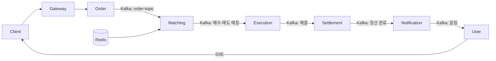

# FinPago Backend

해외주식 주문·체결·정산과 투자 정보 조회를 구현한 6인 팀 프로젝트입니다.
**신한투자증권 프로 디지털 아카데미 5기 최종 프로젝트 최우수상**을 수상했습니다.

이 저장소는 [팀 백엔드 저장소](https://github.com/Pda-Final-Project/backend)의 개인 포크입니다.

## Tech Stack

**Java 17 · Spring Boot 3.4.2 · Spring Data JPA · MySQL · Kafka · Redis**  
Spring Security · JWT · Spring Cloud Gateway · Eureka · SSE  
AWS · Docker · Kubernetes · Jenkins · ArgoCD

## 팀 시스템 아키텍처

### 주요 기능과 서비스

| 서비스 | 담당 기능 |
| --- | --- |
| [order-service](./order-service) | 주문 접수, 예수금·보유 주식 검증, 주문 이벤트 발행 |
| [matching-service](./matching-service) | Redis의 최근 체결 데이터를 활용한 매수·매도 주문 매칭 |
| [execution-service](./execution-service) | 체결 기록과 상태 저장, 정산 이벤트 발행 |
| [settlement-service](./settlement-service) | 예수금·환율·거래 내역 반영, 정산 결과 이벤트 발행 |
| [user-service](./user-service) | 회원·계좌·보유 종목·관심 종목 관리, 알림 조회·SSE 전송, 예수금 배치 반영 |
| [data-service](./data-service) · [filling-service](./filling-service) | 시세·차트·환율·뉴스·공시 조회, Redis Pub/Sub 기반 시세 SSE 전송 |
| [notification-service](./notification-service) | 정산 완료·공시 이벤트를 사용자 알림으로 전달 |
| [gateway](./gateway) · [service-discovery](./service-discovery) · [common](./common) | API 라우팅, 서비스 탐색, 공통 이벤트·응답·예외 정의 |

### 주문 처리 흐름

- **Kafka 이벤트 연계:** 주문 접수, 매칭, 체결, 정산, 알림을 서비스별로 분리하고 이벤트로 연결했습니다.
- **Redis 활용:** 최근 체결가·환율과 사용자 예수금·보유 종목 데이터를 조회·갱신하고, Pub/Sub 메시지를 SSE로 전달합니다.
- **실시간 체결창:** 최근 체결 데이터를 Redis List에 저장하고, 신규 체결 이벤트를 Pub/Sub와 종목별 SSE 구독으로 전달합니다.
- **소비 실패 처리:** 주문·정산 서비스의 Kafka 소비 오류에 1초 간격 3회 재시도를 설정하고, 이후 DLT로 분리합니다. 주문 DLT는 실패 상태를 기록하고, 정산 DLT는 체결 서비스로 실패 이벤트를 전달합니다.
- **예수금 배치:** 정산 시 D+2 날짜의 예수금 데이터를 Redis에 저장하고, 매일 실행되는 스케줄러가 해당 날짜의 데이터를 DB에 반영합니다.
- **배포 구성:** Jenkins에서 서비스별 Docker 이미지를 빌드·푸시하고, 별도 ArgoCD 저장소의 Kubernetes 매니페스트에 이미지 버전을 반영합니다.

구현: [주문](./order-service/src/main/java/finpago/orderservice/order/service/OrderService.java) · [매칭](./matching-service/src/main/java/finpago/matchingservice/matching/service/MatchingService.java) · [체결](./execution-service/src/main/java/finpago/executionservice/execution/service/ExecutionService.java) · [정산](./settlement-service/src/main/java/finpago/settlementservice/settlement/service/SettlementService.java) · [재시도 설정](./settlement-service/src/main/java/finpago/settlementservice/settlement/config/kafka/KafkaRetryConfig.java) · [배치](./user-service/src/main/java/finpago/userservice/user/service/TradingSettlementBatchService.java) · [Jenkins](./Jenkinsfile.groovy) · [Kubernetes 매니페스트](https://github.com/Pda-Final-Project/argocd/tree/main/apps)

## 개인 담당 및 기여

백엔드 개발과 핵심 거래 흐름의 설계·구현에 참여했습니다.

- **거래 처리:** Kafka 기반 주문 → 매칭 → 체결 → 정산 흐름 설계·구현에 참여하고, 체결·정산 로직과 Redis 데이터 관리, Kafka 연동에 직접 기여했습니다.
- **이벤트 처리:** 직렬화·역직렬화 문제를 해결하고, 실패 이벤트 분리와 재시도·DLT 처리, 재처리 흐름의 구현·검증에 참여했습니다.
- **실시간 체결창:** 외부·내부 체결 데이터를 전달하는 Redis List → Pub/Sub → SSE 흐름을 구현했습니다.
- **배포 연동·장애 대응:** AWS·Docker·Jenkins·Kubernetes·ArgoCD 환경에서 서비스 배포 연동과 설정 확인에 참여했습니다. SSE 장기 연결의 Gateway timeout 문제를 분석하고 ALB 연결 경로 조정에 참여했습니다.

관련 구현: [체결 로직](./execution-service/src/main/java/finpago/executionservice/execution/service/ExecutionService.java) · [정산 로직](./settlement-service/src/main/java/finpago/settlementservice/settlement/service/SettlementService.java) · [체결 SSE](./execution-service/src/main/java/finpago/executionservice/execution/service/TradeSseService.java) · [Redis 구독 설정](./execution-service/src/main/java/finpago/executionservice/execution/config/redis/RedisListenerConfig.java) · [매칭 로직 개선 PR](https://github.com/Pda-Final-Project/backend/pull/114)
